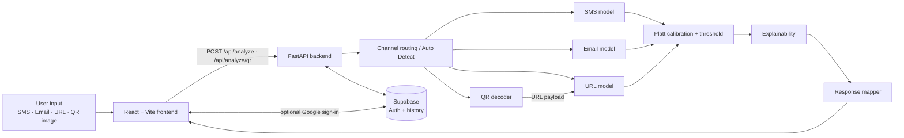

<div align="center">

# CyberNexus

**Machine Learning-Based Multi-Channel Phishing and Threat Detection System**

*Check before you trust.* Paste an SMS, an email, or a URL, or upload a QR code, and get a calibrated verdict together with a clear explanation of why.

</div>

<!-- TODO: add a screenshot after the UI is final, then uncomment:

-->

CyberNexus is a project-based learning (PBL) project built at the Department of Computer Science and Engineering, Chennai Institute of Technology (Anna University, Chennai). It analyses four kinds of input through channel-specific machine-learning pipelines, explains each verdict from the model's own evidence, and works as a guest with no account needed.

---

## Table of Contents

1. [Why CyberNexus](#why-cybernexus)
2. [How it works](#how-it-works)
3. [Features](#features)
4. [Technology stack](#technology-stack)
5. [Project structure](#project-structure)
6. [Getting started](#getting-started)
7. [Datasets](#datasets)
8. [Train the models yourself](#train-the-models-yourself)
9. [API overview](#api-overview)
10. [Testing](#testing)
11. [Scope and known limitations](#scope-and-known-limitations)
12. [Troubleshooting](#troubleshooting)
13. [Team and references](#team-and-references)

---

## Why CyberNexus

- **One workspace, four channels.** SMS, email, URL and QR codes are handled in a single interface, and Auto Detect picks the right pipeline for you.
- **Explainable by design.** Every result lists the signals behind the verdict. For the text models these are the words and structural features with their contributions. For URLs they are per-feature contributions from the LightGBM model. Nothing is generated by a language model or invented by the interface.
- **Calibrated confidence.** Scores go through sigmoid (Platt) calibration, so the confidence shown is a probability estimate and not a raw model score.
- **Lightweight and local.** The models are classical ML (Logistic Regression and LightGBM). They run on a CPU, load once at startup and answer in a fraction of a second. No GPU or paid API is required.
- **Safe by construction.** URLs are analysed from their structure only. CyberNexus never visits a link, and QR codes are decoded and analysed without opening their destination.
- **Guest-first, account-optional.** Guest analyses are never stored. Signing in with Google adds private, per-user history that is enforced with database row-level security.
- **Reproducible.** The pipeline from raw data to trained models is scripted with fixed seeds, leak-free train/validation/test splits, and fold-safe feature fitting, so you can rebuild the models on your own machine.
- **Tested.** The backend and frontend ship with automated test suites covering the API contract, QR handling, authentication, history and the frontend state logic.

## How it works



| Channel | Model | Input features | Explanation |
|---|---|---|---|
| **SMS** | Logistic Regression | TF-IDF word and bigram features plus structural features | Coefficient-based token and feature contributions |
| **Email** | Logistic Regression | Separate Subject and Body TF-IDF plus structural features | Coefficient-based contributions, with Subject and Body kept apart |
| **URL** | LightGBM | 15 lexical and structural URL features | Per-feature contributions (TreeSHAP-style) |
| **QR** | zxing-cpp decoder, then the URL model | Decoded payload | URL payloads reuse the URL pipeline. Other payloads are decoded and reported without a verdict, and several codes in one image are listed separately |

Decision thresholds are set per channel and stored with the trained models.

## Features

- Analyse SMS, email (subject and body separately), URLs and QR images
- Auto Detect for pasted content
- Verdict, calibrated confidence, key indicators, recommended action, and a detailed ML view
- Subject and Body attribution for email
- Google sign-in through Supabase (optional)
- Saved analysis history per account: reopen, delete one, delete all, or delete the account
- Sample inputs on the landing page for a quick tour
- Loading, error and retry handling across the interface

## Technology stack

| Layer | Technologies |
|---|---|
| Frontend | React, TypeScript, Vite, Tailwind CSS |
| Backend | Python, FastAPI, Uvicorn, Pydantic |
| Machine learning | scikit-learn, LightGBM, NumPy, SciPy, pandas, joblib |
| QR | Pillow, zxing-cpp |
| Auth and storage | Supabase (Google OAuth, Postgres with row-level security) |
| Testing | `unittest` (backend), Node test runner via `tsx` (frontend), `tsc` type checking |

## Project structure

```text
CyberNexus/
├── README.md
├── .gitignore
├── .env.example                    # backend environment template
├── requirements.txt                # backend and inference dependencies
├── requirements-train.txt          # extra packages for training and evaluation
│
├── backend/                        # FastAPI service
│   ├── app.py                      # app startup, middleware, health and auth endpoints
│   ├── config.py                   # environment-driven settings
│   ├── schemas.py                  # request and response models
│   ├── routers/                    # analysis, history, account routes
│   ├── services/                   # ml_service, qr_service, auth_service,
│   │                               #   supabase_service, response_mapper
│   ├── db/migrations/              # Supabase SQL (schema, RLS), apply in order
│   └── tests/
│
├── ml/                             # everything that builds and serves the models
│   ├── preprocessing/              # cleaning, de-duplication, stratified splits
│   ├── feature_engineering/        # features, TF-IDF vectorizers, scalers
│   ├── training/                   # model comparison and final training
│   ├── calibration/                # Platt calibration and threshold selection
│   ├── evaluation/                 # evaluation and error analysis
│   ├── explainability/             # per-channel explainers used at runtime
│   └── models/                     # trained model artifacts
│
├── frontend/                       # React + Vite single-page app
│   ├── package.json
│   ├── .env.example                # frontend environment template
│   ├── public/                     # static assets
│   └── src/
│       ├── components/             # workspace, composer, results, modals
│       ├── hooks/                  # auth session and history state
│       ├── lib/                    # API client and result adapter
│       ├── data/                   # sample inputs for the landing page
│       └── tests/
│
├── data/                           # datasets (not stored in Git)
│   ├── README.md                   # sources, file list, checksums
│   └── MANIFEST.json               # expected checksums and row counts
│
├── scripts/                        # setup_data, verify_data, run_pipeline helpers
└── docs/                           # architecture, methodology and design notes
```

## Getting started

### Prerequisites

- **Python** 3.x. <!-- TODO: replace with the exact tested version(s) after the clean-install test -->
- **Node.js** 18 or newer, with npm
- **Git**
- *(Optional)* a free [Supabase](https://supabase.com) project, for Google sign-in and saved history

### 1. Clone the repository

```bash
git clone https://github.com/Kamalesh-tech31/CyberNexus.git
cd CyberNexus
```

### 2. Start the backend

Create and activate a virtual environment, then install the dependencies.

**Windows (PowerShell)**

```powershell
python -m venv .venv
Set-ExecutionPolicy -Scope Process -ExecutionPolicy RemoteSigned
.\.venv\Scripts\Activate.ps1
pip install -r requirements.txt
```

**macOS / Linux**

```bash
python3 -m venv .venv
source .venv/bin/activate
pip install -r requirements.txt
```

Run the server from the repository root:

```bash
python -m uvicorn backend.app:app --host 127.0.0.1 --port 8000 --reload
```

Check that it is running: <http://127.0.0.1:8000/api/health>

The backend needs the trained model files in `ml/models/` and `ml/feature_engineering/artifacts/`. <!-- TODO: confirm after deciding whether artifacts ship in the repo -->
If they are not present in your copy, follow [Train the models yourself](#train-the-models-yourself).

### 3. Start the frontend

In a second terminal:

```bash
cd frontend
npm ci
```

Copy the environment template, then start the dev server.

**Windows (PowerShell):** `copy .env.example .env`  
**macOS / Linux:** `cp .env.example .env`

```bash
npm run dev
```

Open <http://localhost:5173>. By default the frontend talks to `http://127.0.0.1:8000`, which is set by `VITE_API_BASE_URL` in `frontend/.env`.

### 4. Try it as a guest

No account or Supabase project is needed. Click one of the sample cards or paste your own content and press Enter. <!-- TODO: confirm guest-only start without Supabase variables in the clean-run test -->

### 5. Optional: enable Google sign-in and history

1. Create a Supabase project.
2. In **Authentication → Providers**, enable **Google**, and add `http://localhost:5173` as an allowed redirect URL.
3. In the Supabase SQL editor, run the files in `backend/db/migrations/` in numeric order.
4. Fill in the environment files. Variable names are listed in `.env.example` (backend) and `frontend/.env.example` (frontend).
   - The frontend uses only the project URL and the public **anon** key.
   - The backend uses the server-side credentials, including the JWT secret. **Never put these in the frontend, and never commit a real `.env` file.**
5. Restart the backend and the frontend.

## Datasets

The datasets are too large for GitHub, so they are shared as a single archive.

> **Download:** [`CyberNexus-datasets.zip`](DATASET_ZIP_URL) <!-- TODO: replace DATASET_ZIP_URL with the release or Zenodo link -->

Extract it into the repository's `data/` folder so the layout looks like this:

```text
data/
├── sms/SMSSpamCollection
├── email/   CEAS_08.csv  Enron.csv  Ling.csv  Nazario.csv
│            Nigerian_Fraud.csv  SpamAssasin.csv
└── url/phishing_site_urls.csv
```

Then verify the files:

```bash
python scripts/verify_data.py
```

| Channel | Dataset | Notes |
|---|---|---|
| SMS | UCI SMS Spam Collection v1 | Labelled ham and spam messages (Almeida et al., 2011) |
| Email | Combined corpus of six public sources | CEAS 2008, Enron, Ling, Nazario, Nigerian Fraud, SpamAssassin |
| URL | Phishing Site URLs (Kaggle) | Labelled good and bad URLs |

Please check each dataset's original terms before reusing or redistributing it. Sources, checksums and expected row counts are listed in `data/README.md` and `data/MANIFEST.json`.

## Train the models yourself

You can rebuild every model from the raw datasets on a normal laptop CPU. <!-- TODO: add measured runtimes after the clean-run test -->

```bash
pip install -r requirements-train.txt

python scripts/verify_data.py        # check the raw files
python scripts/run_pipeline.py       # run all channels
# or one channel at a time:
python scripts/run_pipeline.py --only sms
python scripts/run_pipeline.py --only email
python scripts/run_pipeline.py --only url
```

<!-- TODO: confirm the script names and flags against scripts/run_pipeline.py -->

The pipeline runs these stages for each channel:

1. **Clean and split.** It removes duplicates and malformed rows, then makes a stratified 70 / 15 / 15 train, validation and test split with a fixed seed (42). De-duplication happens before splitting, so no row appears in two splits.
2. **Feature engineering.** TF-IDF vectorizers and scalers are fitted on the training split only, then applied to validation and test data.
3. **Training.** Candidate models are compared on the validation split and the best configuration is trained.
4. **Calibration.** Sigmoid (Platt) calibration is fitted on the validation split, and each channel's decision threshold is chosen from validation data.
5. **Evaluation.** The held-out test split is scored once at the end.

Retraining writes new artifacts to `ml/models/` and `ml/feature_engineering/artifacts/`, **replacing the existing ones**, so copy those folders first if you want to keep the originals. The metrics from your own run are printed by the evaluation step and saved under `ml/evaluation/`. <!-- TODO: confirm output location -->

## API overview

| Method | Path | Auth | Purpose |
|---|---|---|---|
| GET | `/api/health` | none | Service health |
| POST | `/api/analyze` | optional | Analyse SMS, email or URL text, with `channel` set to `auto`, `sms`, `email`, `url` or `qr` |
| POST | `/api/analyze/qr` | optional | Analyse an uploaded QR image |
| GET | `/api/auth/me` | required | Current user |
| GET | `/api/history` | required | List your saved analyses |
| GET | `/api/history/{id}` | required | Open one saved analysis |
| DELETE | `/api/history/{id}` | required | Delete one analysis |
| DELETE | `/api/history` | required | Delete all of your history |
| DELETE | `/api/account` | required | Delete your account and data |

**Guest requests send no token and are never stored.** Signed-in requests send `Authorization: Bearer <Supabase access token>`, and the server works out the user from the verified token.

```bash
curl -X POST http://127.0.0.1:8000/api/analyze \
  -H "Content-Type: application/json" \
  -d '{"channel": "auto", "input": "paste any message or URL here"}'
```

For email, send `"channel": "email"`, the body in `input`, and the subject in `subject`. Each response includes the prediction, calibrated confidence, risk score, human-readable reasons, a recommendation, and detailed feature and token contributions. Signed-in responses also carry an `analysis_id`.

FastAPI's interactive documentation is available at <http://127.0.0.1:8000/docs> while the backend is running. <!-- TODO: confirm /docs is enabled -->

## Testing

Run the backend tests from the repository root. They use mocks and do not need a Supabase project:

```bash
python -m unittest discover -s backend/tests
```

Run the explainability tests:

```bash
python -m unittest discover -s ml/explainability/tests
```

Run the frontend type check, tests and build from `frontend/`:

```bash
npm run lint
npx tsx --test src/tests/*.test.ts
npm run build
```

One backend test, a real Supabase end-to-end test, is skipped unless you configure a live project.

## Scope and known limitations

CyberNexus is a learning project and a decision aid, not a replacement for enterprise security tools. These boundaries are worth knowing:

- **URL analysis is static.** It reads a link's structure only. It does not visit the page or check domain age, DNS or reputation services. The destination of a shortened link cannot be verified.
- **Training data comes from public research corpora.** Newer message styles, such as one-time-passcode texts, routine service notifications or scams with no link at all, may be judged less reliably than the styles the models were trained on. Treat results as guidance and confirm through the official channel when it matters.
- **QR analysis needs a readable image.** Blurred or damaged codes cannot be decoded.
- **Confidence is an estimate, not a guarantee.** Explanations describe how the model reached its verdict, not the sender's intent.

**Where it could go next:** refreshing the training data with newer samples, adding richer URL signals, and continuous evaluation as threats change.

## Troubleshooting

| Problem | What to try |
|---|---|
| Backend fails at startup with a missing model or vectorizer file | The artifacts are not in `ml/models/` or `ml/feature_engineering/artifacts/`. Add them or run the [training pipeline](#train-the-models-yourself). |
| `Activate.ps1` is blocked on Windows | Run `Set-ExecutionPolicy -Scope Process -ExecutionPolicy RemoteSigned` in that terminal, then activate again. |
| `pip install` fails on `zxing-cpp` or `lightgbm` | Use a Python version the packages publish wheels for (see Prerequisites) and upgrade pip first. |
| The frontend cannot reach the backend | Check that the backend is running and that `VITE_API_BASE_URL` in `frontend/.env` matches its address. Restart `npm run dev` after editing `.env`. |
| Browser CORS error | The backend allows local development origins by default. Add your origin to the backend settings if you serve the frontend elsewhere. |
| Google sign-in does not open or returns an error | Confirm the Google provider is enabled in Supabase and that your frontend URL is an allowed redirect URL. |
| Port 8000 or 5173 is already in use | Choose another port, and update `VITE_API_BASE_URL` if you change the backend's. |

## Team and references

**Team:** Kamalesh K (project lead, ML development and system integration) and Vetrivel V (verification, testing and project support).  
**Mentor:** Ms. Kalpana A, Assistant Professor, Department of Computer Science and Engineering, Chennai Institute of Technology.

**References**

1. T. A. Almeida, J. M. G. Hidalgo, A. Yamakami, "Contributions to the study of SMS spam filtering: new collection and results," ACM Symposium on Document Engineering, 2011. Dataset: SMS Spam Collection, UCI Machine Learning Repository, doi:10.24432/C5CC84.
2. G. Ke et al., "LightGBM: A Highly Efficient Gradient Boosting Decision Tree," Advances in Neural Information Processing Systems 30, 2017.
3. S. M. Lundberg, S.-I. Lee, "A Unified Approach to Interpreting Model Predictions," Advances in Neural Information Processing Systems 30, 2017.
4. A. Niculescu-Mizil, R. Caruana, "Predicting Good Probabilities with Supervised Learning," ICML 2005, doi:10.1145/1102351.1102430.
5. A. Al-Subaiey et al., "Novel Interpretable and Robust Web-based AI Platform for Phishing Email Detection," arXiv:2405.11619, 2024.
